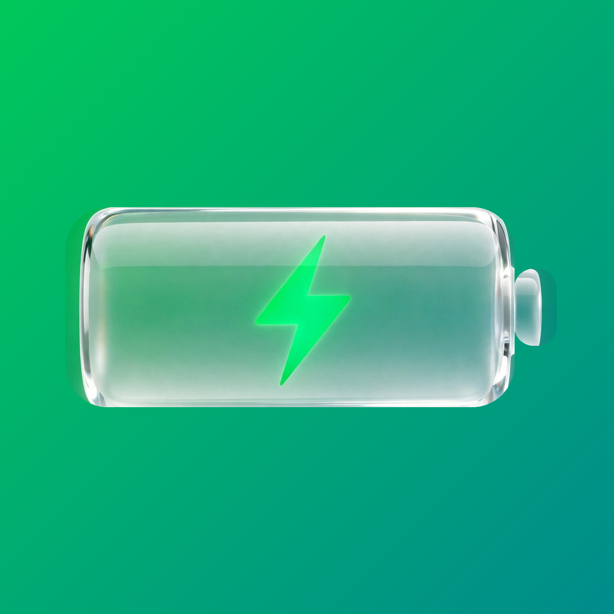
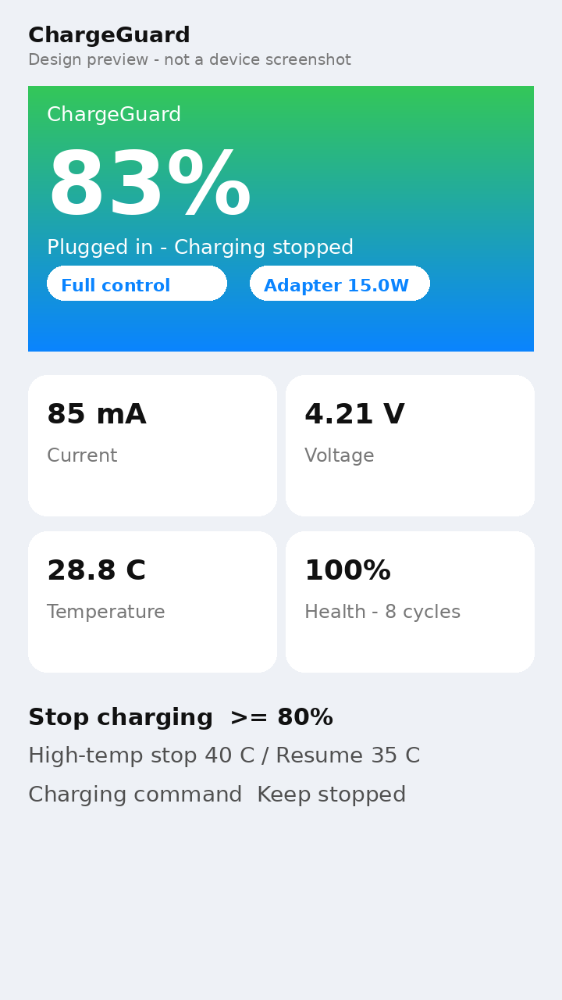
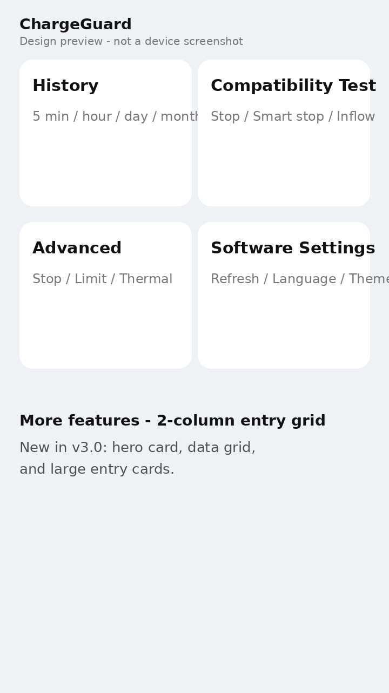
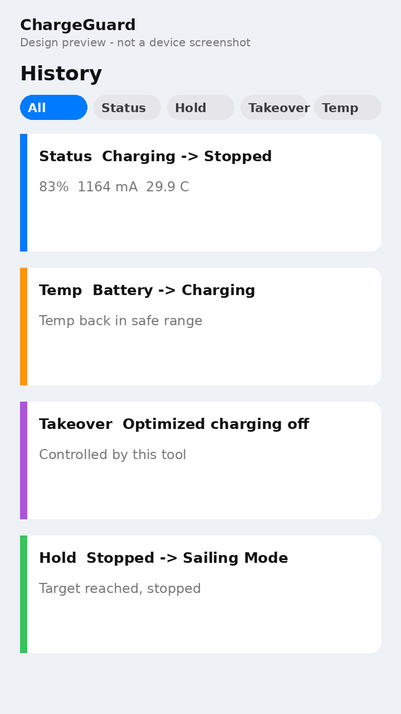

# ChargeGuard

中文 · **[English](#introduction)**

ChargeGuard（充电守卫，简称 CG）是面向 iPhone 的充电控制工具：把电量停在你设定的值，避开高温满充，延长电池寿命。它不是硬件旁路充电，而是软件层充电策略控制。仓库为 xstar68/ChargeGuard，应用、包、守护进程与数据标识均为 ChargeGuard；源码目录与类名前缀、URL Scheme `cl` 仍为技术内部标识，不影响使用。

## 界面介绍



下图为**新界面设计预览**（按 v3 界面设计稿绘制，不是真机截图；真机截图待 v3.0 真机测试后补充）：

| 主界面 | 更多功能 | 历史统计 |
| --- | --- | --- |
|  |  |  |

## 这是什么

- 打开就是新主界面：大电量状态卡、实时数据卡、一键预设、更多功能入口，不再是旧版长列表。
- 停充：电量达到设定值就停止充电；禁流、限流、插电保持、满充计划、温度控制、系统优化充电协调都在充电高级里。
- 默认值：停止充电 80%、高温停充 40°C、降温恢复 35°C、开始充电 20%。
- 注意：软件停充不是物理断电，个别设备停充后仍有几十毫安残留电流属于正常软停，不是 bug。
- 最低 iOS 13.0；需要 TrollStore 或越狱环境，无法上架 App Store，也无法用常规自签安装。

## 下载安装

下载：<https://github.com/xstar68/ChargeGuard/releases>

| 环境 | 产物 |
| --- | --- |
| TrollStore | `ChargeGuard_<版本>_TrollStore.tipa` |
| 越狱 rootful | `ChargeGuard_<版本>_rootful_arm.deb` |
| 越狱 rootless | `ChargeGuard_<版本>_rootless_arm64.deb` |
| 越狱 roothide | `ChargeGuard_<版本>_roothide_arm64e.deb` |

- deb 版只安装在系统设置里，桌面不留图标；TrollStore 的 tipa 仍留在桌面。
- deb 版安装新版会自动顶掉旧包（`com.chargelimiter.mod`），并把旧配置目录迁移到新目录，旧目录会保留作回退。
- TrollStore 环境安装新版前请先卸载旧版。
- 装完先做一件事：打开设置里的 ChargeGuard，确认 80% 停充、温度控制、高级开关都能正常打开和保存，再正常使用。

## 基本使用

1. 主界面确认当前状态：正在充电 / 已连接电源 · 停止充电 / 温控暂停充电 / 插电保持中。
2. 拖动“停止充电”滑块设上限，松手后写一次；温度控制开关打开后，设置高温停充和降温恢复。
3. 充电高级里按需开：智能停充、停充时禁流、插电保持、满充计划、高温模拟 / 充电限流。
4. 历史统计看 5 分钟 / 小时 / 天 / 月曲线；策略诊断看当前为什么停充或恢复充电。
5. 自动化可用 URL Scheme：`cl:///` 打开，`cl:///charge` 启用充电，`cl:///nocharge` 停用充电。

## 从源码构建

```bash
./scripts/build_packages.sh
```

产物在 `out/`，命名同上表。单独验证编译：

```bash
xcodebuild -project ChargeGuard.xcodeproj -scheme "ChargeGuard" -destination "generic/platform=iOS" -configuration Release -derivedDataPath build_rootful CODE_SIGNING_ALLOWED=NO ARCHS=arm64
xcodebuild -project ChargeGuard.xcodeproj -scheme "ChargeGuard rootless" -destination "generic/platform=iOS" -configuration Release -derivedDataPath build_rootless CODE_SIGNING_ALLOWED=NO ARCHS=arm64
xcodebuild -project ChargeGuard.xcodeproj -scheme "ChargeGuard roothide" -destination "generic/platform=iOS" -configuration Release -derivedDataPath build_roothide CODE_SIGNING_ALLOWED=NO ARCHS=arm64 THEOS_PACKAGE_SCHEME=roothide
```

详细构建说明见 [构建安装包.md](构建安装包.md)，版本历史见 [CHANGELOG.md](CHANGELOG.md)。

问题反馈请前往 [Issues](https://github.com/xstar68/ChargeGuard/issues)。

基于 lich4 与 tunecc 的工作更新维护。

---

## Introduction

**English · [中文](#chargeguard)**

ChargeGuard (CG for short) is a charging-control tool for iPhone: stop charging at the capacity you set, avoid hot full charges, and extend battery life. It is software-level charging-policy control, not hardware bypass charging. The repository is xstar68/ChargeGuard and the app, package, daemon, and data identifiers are all ChargeGuard; the source directory, class prefixes, and the URL scheme `cl` remain technical internal identifiers and do not affect use.

## What it is

- A new main screen on open: a large capacity status card, live data cards, one-tap presets, and feature entries — not the old long list.
- Stop charging at your set limit; disable inflow, limit inflow, plug-in hold, full-charge schedule, temperature control, and Optimized Battery Charging coordination are in Advanced.
- Defaults: stop charging 80%, over-temp stop 40°C, cool-down resume 35°C, start charging 20%.
- Note: software stop is not a physical disconnect. A residual current of tens of milliamps on some devices after stopping is a normal soft stop, not a bug.
- Requires iOS 13.0 or later, plus TrollStore or a jailbreak. It cannot be on the App Store and cannot be installed with a regular sideload.

## Download and install

Download: <https://github.com/xstar68/ChargeGuard/releases>

| Environment | Package |
| --- | --- |
| TrollStore | `ChargeGuard_<version>_TrollStore.tipa` |
| Jailbreak rootful | `ChargeGuard_<version>_rootful_arm.deb` |
| Jailbreak rootless | `ChargeGuard_<version>_rootless_arm64.deb` |
| Jailbreak roothide | `ChargeGuard_<version>_roothide_arm64e.deb` |

- The deb installs only in system Settings, with no home-screen icon; the TrollStore tipa stays on the home screen.
- The deb replaces the old package (`com.chargelimiter.mod`) and migrates the old config directory to the new one; the old directory is kept as a fallback.
- On TrollStore, uninstall the old version before installing a new one.
- After installing, first check that the 80% stop, temperature control, and Advanced switches open and save normally in Settings.

## Basic use

1. Check the current state on the main screen: charging / plugged in · stopped / paused by temperature / holding.
2. Drag the stop-charging slider to your limit; it writes once on release. Turn on temperature control, then set the over-temp stop and cool-down resume values.
3. In Advanced, enable as needed: smart stop, disable inflow on stop, plug-in hold, full-charge schedule, thermal simulation / charging limit.
4. History shows 5-minute / hourly / daily / monthly charts; Policy diagnostics shows why charging stopped or resumed.
5. Automation via URL scheme: `cl:///` opens the app, `cl:///charge` enables charging, `cl:///nocharge` stops charging.

## Build from source

```bash
./scripts/build_packages.sh
```

Packages land in `out/` with the names in the table above. Verify a single build with:

```bash
xcodebuild -project ChargeGuard.xcodeproj -scheme "ChargeGuard" -destination "generic/platform=iOS" -configuration Release -derivedDataPath build_rootful CODE_SIGNING_ALLOWED=NO ARCHS=arm64
xcodebuild -project ChargeGuard.xcodeproj -scheme "ChargeGuard rootless" -destination "generic/platform=iOS" -configuration Release -derivedDataPath build_rootless CODE_SIGNING_ALLOWED=NO ARCHS=arm64
xcodebuild -project ChargeGuard.xcodeproj -scheme "ChargeGuard roothide" -destination "generic/platform=iOS" -configuration Release -derivedDataPath build_roothide CODE_SIGNING_ALLOWED=NO ARCHS=arm64 THEOS_PACKAGE_SCHEME=roothide
```

See [构建安装包.md](构建安装包.md) for build details and [CHANGELOG.md](CHANGELOG.md) for version history.

Report issues at [Issues](https://github.com/xstar68/ChargeGuard/issues).

Based on the work of lich4 and tunecc.
